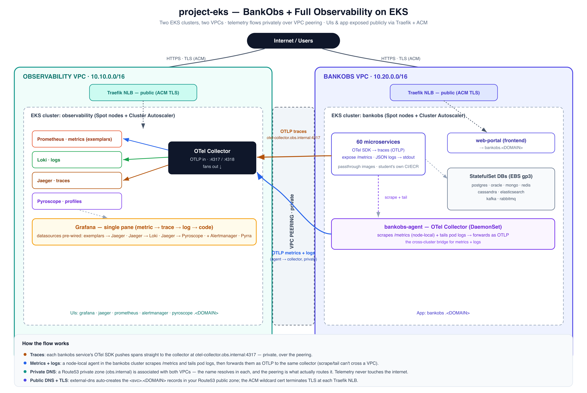

# project-eks — BankObs + full observability on EKS, the real way

Two EKS clusters in two VPCs: one runs the **observability stack**, the other runs **BankObs**
(60 microservices). Telemetry flows **privately** between them over VPC peering; the UIs and the
app frontend are exposed publicly through Traefik with your own DNS + ACM cert.



> Traces are pushed straight to the collector by each service's OTel SDK; **metrics and logs**
> are gathered by a node-local **bankobs-agent** (scrape `/metrics` + tail logs) and forwarded OTLP —
> all privately over the VPC peering. ([editable source](docs/architecture.svg))

## Three layers

| Folder | What it does | Entry |
|---|---|---|
| [`cluster/`](cluster) | Terraform: 2 VPCs + peering + private zone + 2 EKS + Spot nodes + addons | `make apply` |
| [`observability/`](observability) | Helm: Collector, kube-prometheus-stack, Loki, Jaeger, Pyroscope, Pyrra | `make all` |
| [`app/`](app) | BankObs: 60 per-service charts (passthrough Dockerfiles) + platform StatefulSets | `make all` |

## End-to-end

```bash
# 1. Clusters (supply YOUR public zone, domain, wildcard ACM cert)
cd cluster
make apply ZONE_ID=Z0123... DOMAIN=lab.example.com ACM_ARN=arn:aws:acm:us-east-1:111122223333:certificate/abcd
make kubeconfig                      # both clusters into your kubeconfig

# 2. Observability stack (obs cluster)
cd ../observability && make all DOMAIN=lab.example.com 


# 3. BankObs (bankobs cluster) — LICENSE_KEY is required (the app images gate on it)
cd ../app && make all DOMAIN=lab.example.com LICENSE_KEY=eyJ...
```

> **`LICENSE_KEY` is required** for step 3 — every bankobs Java service calls `license-checker`
> on boot and refuses to start without a valid license. Pass it inline (above) or drop
> `LICENSE_KEY=eyJ...` into `app/.env` (git-ignored). Telemetry still flows without it, but the
> services won't come up.
>
> **Oracle** (`oracle-0`) takes ~5-10 min on first boot (datafile creation); the few core-banking
> services that depend on it stay down until it's ready. Everything else comes up in a couple of minutes.

Then: `https://grafana.lab.example.com` (single pane), `https://bankobs.lab.example.com` (app),
and fault injection via `kubectl -n bankobs scale deploy/fault-injector --replicas=1`.

## Cost & teardown

Spot nodes keep it cheap, but two EKS control planes + NAT + NLBs + EBS still cost real money.
Tear down in reverse: `app → observability → cluster` (`make destroy` in each), and finally
`cd cluster && make destroy`.

## Design notes

- **Spot everywhere**, diversified instance sets + **Cluster Autoscaler** so a Spot interruption
  can't drain a cluster.
- **Private telemetry**: a Route53 private zone shared by both VPCs resolves `otel-collector.obs.internal`;
  the peering is what actually routes it. Telemetry never touches the internet.
- **Public endpoints**: EKS API is public (kubectl from anywhere); UIs/frontend via Traefik + external-dns + ACM.
- **BankObs images stay private to you**: each service is a passthrough `FROM`, so students can wire
  their own ECR + CI/CD without the source.

## Versions

Pinned, current as of the last refresh. EKS defaults to `1.34` — bump to the latest standard-support
release (`aws eks describe-cluster-versions`).

| Terraform | | Helm charts | |
|---|---|---|---|
| aws provider | `~> 6.0` | kube-prometheus-stack | `92.17.0` |
| helm provider | `~> 3.0` | loki | `7.5.0` |
| kubernetes provider | `~> 3.0` | jaeger (**v2**) | `4.16.1` |
| eks module | `~> 21.0` | pyroscope | `2.4.2` |
| vpc module | `~> 6.0` | opentelemetry-collector | `0.178.1` |
| iam module | `~> 6.0` | cluster-autoscaler | `9.59.0` |
| | | external-dns | `1.23.0` |
| | | traefik | `42.2.0` |
| | | pyrra (image + CRD) | `v0.10.2` |

> These passed `terraform validate` + `helm template` offline. The major jumps — **eks v21 + aws v6**
> and **jaeger v2** — can change resource behavior, so review a `terraform plan` on a live account
> before applying.
