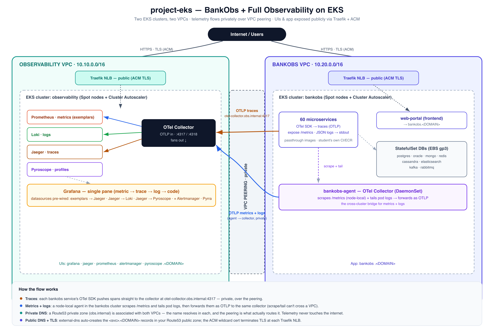

# project-eks-tiny — RoboShop microservices + full observability on EKS

Two EKS clusters in two VPCs: one runs the **observability stack**, the other runs the
**RoboShop microservices** app (9 services across 5 languages + 4 datastores). Telemetry flows
**privately** between them over VPC peering; the UIs and the app frontend are exposed publicly
through Traefik with your own DNS + ACM cert. Nodes are **t3 Spot** to keep it cheap.



> Traces are pushed straight to the collector by each service's OTel instrumentation; **metrics and
> logs** are gathered by a node-local agent (scrape `/metrics` + tail logs) and forwarded OTLP —
> all privately over the VPC peering. ([editable source](docs/architecture.svg))

## Three layers

| Folder | What it does | Entry |
|---|---|---|
| [`cluster/`](cluster) | Terraform: 2 VPCs + peering + private zone + 2 EKS + Spot nodes + addons | `make apply` |
| [`observability/`](observability) | Helm: Collector, kube-prometheus-stack, Loki, Jaeger, Pyroscope | `make all` |
| [`roboshop-microservices/`](roboshop-microservices) | RoboShop: 9 instrumented services (5 langs) + 4 datastores + k6 load injector | `make deploy` |

## End-to-end (no license, images are prebuilt & public)

```bash
# one command for everything:
make up ZONE_ID=Z0123... DOMAIN=lab.example.com \
        ACM_ARN=arn:aws:acm:us-east-1:111122223333:certificate/abcd

# …or one layer at a time:
cd cluster        && make apply ZONE_ID=Z0123... DOMAIN=lab.example.com ACM_ARN=arn:...
                     make kubeconfig                       # both clusters into your kubeconfig
cd ../observability          && make all DOMAIN=lab.example.com
cd ../roboshop-microservices && make deploy DOMAIN=lab.example.com
```

> The RoboShop images are **prebuilt and public** (public ECR), so no `LICENSE_KEY` and no image
> build is needed to deploy. To rebuild the images yourself (on a Docker host), see
> [`roboshop-microservices/README.md`](roboshop-microservices/README.md) → `make build`.

Then:
- **App** — `https://roboshop.lab.example.com`
- **Traces** — `https://jaeger.lab.example.com/search` (service `payment` → a 6-service distributed trace)
- **Metrics** — `https://prometheus.lab.example.com`
- **Grafana** — `https://grafana.lab.example.com`

**Generate end-to-end traffic** (the trace demo): `make load` (stop with `make load-stop`). Each
virtual shopper walks browse → register → cart → **checkout**, producing one distributed trace
`payment → user → cart → [RabbitMQ] → orders → shipping → notification`.

## Cost & teardown

Spot nodes keep it cheap, but two EKS control planes + NAT + NLBs + EBS still cost real money.
Tear down in reverse: `make destroy` (roboshop → observability → cluster).

## Design notes

- **Spot everywhere**, diversified instance sets so a Spot interruption can't drain a cluster.
- **Private telemetry**: a Route53 private zone shared by both VPCs resolves `otel-collector.obs.internal`;
  the peering is what actually routes it. Telemetry never touches the internet.
- **Public endpoints**: EKS API is public (kubectl from anywhere); UIs/frontend via Traefik + external-dns + ACM.
- **Polyglot instrumentation**: each language gets the right recipe (Java OTel agent + micrometer;
  Go OTel SDK + otelgin/otelsql; Node auto-instrument + prom-bundle + pino; Python
  `opentelemetry-instrument` + prometheus exporter) — all three pillars, uniformly.

## Versions

Pinned, current as of the last refresh. EKS defaults to `1.34` — bump to the latest standard-support
release (`aws eks describe-cluster-versions`).

| Terraform | | Helm charts | |
|---|---|---|---|
| aws provider | `~> 6.0` | kube-prometheus-stack | `92.17.0` |
| helm provider | `~> 3.0` | loki | `7.5.0` |
| kubernetes provider | `~> 3.0` | jaeger (**v2**) | `4.16.1` |
| eks module | `~> 21.0` | pyroscope | `2.4.2` |
| vpc module | `~> 6.0` | opentelemetry-collector | `0.178.1` |
| iam module | `~> 6.0` | cluster-autoscaler | `9.59.0` |
| | | external-dns | `1.23.0` |
| | | traefik | `42.2.0` |

> These passed `terraform validate` + `helm template` offline. The major jumps — **eks v21 + aws v6**
> and **jaeger v2** — can change resource behavior, so review a `terraform plan` on a live account
> before applying.
